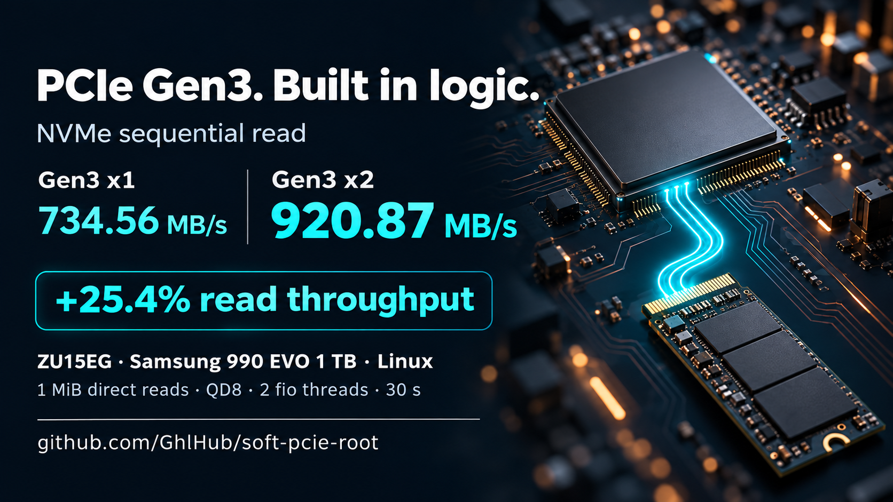

# Soft PCIe Root Port

**PCIe Gen1, Gen2 and Gen3 in FPGA logic, with x1 and x2 links on ZU15EG.**

Custom SystemVerilog implements the PCIe root port and drives one or two
GTHE4 transceivers. A custom Linux PCI host driver connects it to the
standard Linux NVMe driver.



## ZU15EG x1 and x2 results

The ZU15EG and Samsung 990 EVO 1 TB SSD ran matched x1 and x2 sequential
read tests under Linux. Each result is the median of two 30-second runs with
1 MiB direct I/O through fio/libaio at aggregate queue depth 8. Each worker
was pinned to its own Cortex-A53 core and used a separate SSD range.

| PCIe rate | fio workers | x1 read (MB/s) | x2 read (MB/s) | x2 gain |
| --- | ---: | ---: | ---: | ---: |
| Gen1 (2.5 GT/s) | 4 | 213.76 | 305.74 | 43.03% |
| Gen2 (5.0 GT/s) | 4 | 427.19 | 590.74 | 38.28% |
| Gen3 (8.0 GT/s) | 2 | 734.56 | 920.87 | 25.36% |

The staged images negotiated the intended rate and width and passed
read-only NVMe checksum checks with zero SSD writes. The successful Gen2
and Gen3 x2 runs enabled the port before the Linux driver probed it. The
routed Gen3 x2 board design used 50,677 LUTs, 29,620 flip-flops, 3.5 BRAM
tiles and two GTH channels. [ZU15EG hardware results](examples/zu15eg/README.md#gen1-x2-development-stage) ·
[Gen1 data](docs/evidence/zu15eg_gen1_x2_v1/four-core-comparison.json) ·
[Gen2 data](docs/evidence/zu15eg_gen2_x2_v1/four-core-comparison.json) ·
[Gen3 data](docs/evidence/zu15eg_gen3_x2_v1/two-thread-comparison.json)

## Build and test

Use Linux, Python 3.12+, GCC, Icarus Verilog, Verilator and **Vivado 2026.1**
with Zynq UltraScale+ device support. Source Vivado's `settings64.sh` before
running the Vivado commands. AMD XPM and GT Wizard support come from that
installation.

```sh
python3 -m venv .venv
.venv/bin/pip install -r requirements-dev.txt
make test lint
```

### ZU15EG Vivado IP catalog

Generate catalog version **1.2** using a fresh output directory.

```sh
vivado -mode batch -source ip/soft_pcie_root/package.tcl \
  -tclargs build/zu15eg_catalog_1_2 0 zu15eg catalog
```

Add `build/zu15eg_catalog_1_2/core` to Vivado's IP repositories. In the
block design, add **Soft PCIe Root Port (ZU15EG)** and select **PCIe mode**
on its **Configuration** page.

| PCIe mode | DDR AXI at 125 MHz | Outstanding DDR reads |
| --- | ---: | ---: |
| **Gen1/Gen2 x1 (default)** | 64 bits | 2 |
| Gen1/Gen2 x2 | 128 bits | 16 |
| Gen3 x1 | 64 bits | 8 |
| Gen3 x2 | 128 bits | 16 |

The ZU15EG example builds the selected mode with the corresponding board
constraints. Choose the FMC pin profile for your adapter and verify the
carrier's 1.8 V VADJ before programming. [ZU15EG build commands](examples/zu15eg/README.md#vivado-ip-catalog) · [IP integration guide](ip/soft_pcie_root/README.md#zu15eg-catalog)

### ZCU104 x1 example

`make ip` produces catalog version **1.1** for ZCU104. Its **Gen3
(`ENABLE_GEN3`)** checkbox defaults off for Gen1/Gen2 x1. Use fresh output
directories for the package, implementation and audit.

```sh
make ip IP_OUTPUT=build/ip_v1
make hardware OUTPUT=build/zcu104_v1 IP_REPO=build/ip_v1/core
make hardware-audit HARDWARE_OUTPUT=build/zcu104_v1 AUDIT_OUTPUT=build/audit_v1
```

For Gen3 x1, use the same package with the Gen3 board recipe.

```sh
vivado -mode batch -source experiments/gen3/build_host.tcl \
  -tclargs build/zcu104_gen3_next build/ip_v1/core
```

The documented ZCU104 tests used Opsero OP047 Rev D. The supplied U-Boot
power initializer recognizes OP047 only. [ZCU104 board setup](examples/zcu104/README.md#build-the-packaged-ip-example) · [Adapter compatibility](examples/zcu104/README.md#adapter-compatibility)

## ZCU104 Gen3 x1 results

The adaptive review-fix image passed an independent route audit and
physical validation on 2026-11-02. The measurements cover the complete
ZCU104 PL example, including its AXI interconnects.

| Item | Measured result |
| --- | --- |
| FPGA / adapter | ZCU104 with XCZU7EV-2, Opsero OP047 Rev D, SSD in socket SSD1 |
| SSD | Samsung 990 EVO 1 TB |
| Link | **Gen3 x1, 8 GT/s** |
| Software | Linux 6.6.70, custom PCI host driver, standard NVMe driver |
| Sequential read / write, QD8 | **737.37 / 563.84 MB/s** |
| Sequential read / write, QD1 | **591.48 / 339.90 MB/s** |
| Workload | 1 MiB direct I/O through libaio, one job, 30 seconds per workload, decimal MB/s |
| Resources | **16,116 LUTs, 12,367 FFs**, 3 BRAM tiles, one GTH, zero DSPs and URAMs |
| Routed Gen3 setup / hold slack | **+0.041 / +0.010 ns** |
| Hardware checks | Three controlled Gen3 startups, 28,000 configuration reads, eight NVMe performance and integrity jobs, SD warm boot and CRC |

Existing and fresh data CRC, sector-offset CRC, post-flush verification and exact
write accounting passed. SMART error and unsafe-shutdown counters were unchanged.
The image uses adaptive Phase 2/3 equalization and startup-only Gen2
fallback. It became the verified SD boot default on 2026-11-03. Follow-up
testing exercised forced fallback, one same-rate Recovery event during CRC
reads and 33 verified I/O jobs. [Hardware evidence](docs/evidence/adaptive_review_v1/completion.json) · [SD boot evidence](docs/evidence/adaptive_review_v1/default-boot.json) · [Hardware coverage campaign](docs/hardware-coverage.md)

The earlier ZCU104 Gen2 ACK-retirement build measured **428.30 MB/s read**
and **260.21 MB/s write** at QD8. A fresh default Gen2 package build with
the requester timeout fix remains open. [Performance history](docs/performance-history.md#comparable-physical-benchmarks)

## Verification and scope

The staged ZU15EG x2 builds passed reopened route audits. The integrated
x2 regression checkpoint passed **2,510 tests** and real-XPM lint and
elaboration. All four version 1.2 catalog selections passed block-design
output generation and IP synthesis. Board routing and physical checks
for images generated with version 1.2 remain open. [ZU15EG hardware results](examples/zu15eg/README.md#gen3-x2-development-stage) · [Verification history](docs/verification.md)

Cold-start repeatability, full Recovery, broader SSD interoperability and
PCIe compliance remain open. The frozen release scope is Gen1/Gen2 x1.
`make release-check` verifies the frozen source baseline. The shared RTL
changes on `main` fall outside that frozen baseline. [Verification and release scope](docs/verification.md#limits-and-reproducing-measurements)

The design supports one direct endpoint per root port with function 0, up to
16 MiB of endpoint BAR space, noncoherent DMA, and 32 MSI/MSI-X vectors.
The AXI DDR master defaults to 36-bit addressing. Standard example profiles
map the lower 2 GiB of DDR, and the ZU15EG full-DDR profile maps both banks.
Accepted AXI requests must drain before
a local reset. Switch topology, Type 1 routing, multifunction, INTx, hotplug,
ASPM/AER and safe live PL replacement are outside this scope. [Integration guide](docs/ip-guide.md) · [Register contract](docs/registers.md) · [Roadmap](docs/roadmap.md)

## Repository layout

| Path | Purpose |
| --- | --- |
| `ip/soft_pcie_root/` | Reusable RTL and Vivado IP packager |
| `examples/zcu104/` | IP-based block design, physical constraints and audit |
| `examples/zu15eg/` | ZU15EG x1 and x2 catalog and staged board builds |
| `software/driver/` | GPL-2.0-only Linux PCI host driver |
| `software/linux/` | Reproducible Buildroot/Linux/U-Boot example configuration |
| `tests/` | Protocol, ownership, DMA, CDC and software regressions |
| `docs/` | IP guide, register contract, validation and release notes |
| `docs/media/` | Editable graphic, PNG and LinkedIn draft |

## Licensing

Original RTL, tools and documentation: **Apache-2.0**. The Linux host driver in
`software/driver/` remains **GPL-2.0-only**. AMD-generated IP/libraries and fetched
upstream software retain their own licenses. The GPL pcievhost oracle is optional,
test-only and fetched into ignored build output; it is not synthesized or vendored.
See [LICENSE](LICENSE), [NOTICE](NOTICE) and [third-party notices](THIRD_PARTY.md).

For the HDL whitespace style and repeatable checks, see [HDL formatting](docs/hdl-formatting.md).
