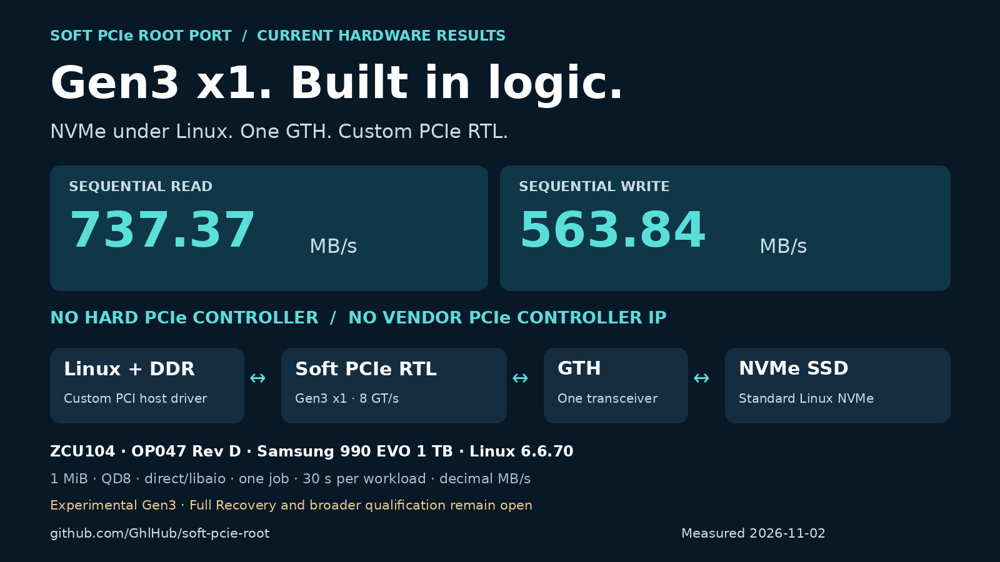

# Soft PCIe Root Port

**Gen3 x1 PCIe in FPGA logic: 737.37 MB/s read and 563.84 MB/s write with an NVMe SSD under Linux.**

A GTH transceiver and custom SystemVerilog implement the PCIe root port, with
no hard PCIe controller or vendor PCIe controller IP. A custom Linux PCI host
driver connects it to the standard Linux NVMe driver.



Current development adds bounded same-rate Recovery, adaptive Phase 2/3
equalization, startup-only Gen2 fallback and prompt configuration-fault reporting.
The latest review-fix image passed fresh route/audit and three controlled Gen3
startups with NVMe I/O on 2026-11-02. It measured 737.37 MB/s read and 563.84 MB/s
write at QD8. It became the verified SD boot default on 2026-11-03; unattended
warm boot and CRC passed. A subsequent [hardware coverage campaign](docs/hardware-coverage.md)
passed forced startup fallback, one injected same-rate Recovery under CRC reads,
and 33 verified I/O matrix jobs. Full Recovery qualification remains open.
See [adaptive equalization and fallback](docs/adaptive-equalization.md) and the
[design-review follow-up](docs/review-followup.md).

## Current Gen3 x1 results

The adaptive review-fix image passed fresh synthesis, place-and-route, independent
checkpoint audit and physical validation on **2026-11-02**. These measurements
cover the complete ZCU104 PL example, including its AXI interconnects.

| Item | Current measured result |
| --- | --- |
| FPGA / adapter | ZCU104, XCZU7EV-2; Opsero OP047 Rev D, SSD1 |
| SSD | Samsung 990 EVO 1 TB |
| Link | **Gen3 x1, 8 GT/s** |
| Software | Linux 6.6.70, custom PCI host driver, standard NVMe driver |
| Sequential read / write, QD8 | **737.37 / 563.84 MB/s** |
| Sequential read / write, QD1 | **591.48 / 339.90 MB/s** |
| Workload | 1 MiB, direct/libaio, one job, 30 seconds per workload; decimal MB/s |
| Resources | **16,116 LUTs, 12,367 FFs**, 3 BRAM tiles, one GTH; no DSP or URAM |
| Routed Gen3 setup / hold slack | **+0.041 / +0.010 ns** |
| Hardware checks | Three controlled Gen3 startups; 28,000 configuration reads; eight NVMe performance/integrity jobs; SD warm boot and CRC |

Existing and fresh data CRC, sector-offset CRC, post-flush verification and exact
write accounting passed. SMART error and unsafe-shutdown counters were unchanged.
The timeout fix prevents a completion accepted on the timeout cycle from leaving
the requester faulted. That exact collision is verified in simulation; it was
not deliberately injected on the SSD.

[Exact hardware evidence](docs/evidence/adaptive_review_v1/completion.json) ·
[Verification scope](docs/verification.md) ·
[Performance history](docs/performance-history.md)

The Gen3 path uses 64-bit host packet transfers, eight 64-byte DDR read-prefetch
slots, an eight-entry replay store and concurrent normal ACK retirement.
The latest full regression passed **1,719 tests**, including 994 independent
Gen3 training, packet, corruption, ownership and rollover cases.
See the [Gen3 coverage matrix](docs/gen3-verification-matrix.md).

**Gen3 x1 is hardware-validated on the documented ZCU104/NVMe setup.**
Full Recovery, cold-cycle qualification, broader
SSD interoperability and PCIe compliance are not established. The current image
passed temporary JTAG testing and subsequently became the
[verified SD default](docs/evidence/adaptive_review_v1/default-boot.json).
No QSPI update was needed. The existing Linux driver remains deployed; the new
early-quarantine software branch has model coverage but has not been deployed.

## x2 development branch

`dev/pcie-x2` integrates the two-lane PHY and a 128-bit host/DDR path for the
staged ZU15EG builds. Gen1, Gen2 and Gen3 x2 negotiated the intended rate and
passed read-only NVMe checks on that board. Gen3 x2 reached **921.21 MB/s**
in a 30-second, two-worker read test. The ordinary IP catalog defaults to x1
and retains its x2 elaboration guard. The x1 baseline is tagged
`x1-hardware-validated-2026-11-08`.
[ZU15EG build and results](examples/zu15eg/README.md) · [x2 development scope](docs/x2-development.md)

## Configuration and earlier results

The unified Vivado **Gen3 (`ENABLE_GEN3`)** checkbox selects Gen3 at build
time. It defaults off, selecting Gen1/Gen2 x1 with 32-bit host packet paths and
two DDR read-prefetch slots. Both selections retain a 64-bit/125 MHz DDR AXI
interface in the x1 builds. The PHY targets UltraScale+ GTHE4.
[Packaging and integration](docs/ip-guide.md#optional-gen3-packaging)

The frozen release remains Gen1/Gen2 x1. The latest measured Gen2 ACK-retirement
build achieved **428.30/260.21 MB/s** at QD8; a fresh Gen2 backend build containing
the requester fix is still outstanding. Historical Gen2/Gen3 results and timing
improvements remain in the [performance history](docs/performance-history.md).
They are separate runs, not interleaved statistical comparisons.

OP047 Rev D is the tested adapter. Its successor OP063 has not been qualified;
the power initializer currently recognizes OP047 only. See
[adapter compatibility](examples/zcu104/README.md#adapter-compatibility).

## Repository layout

| Path | Purpose |
| --- | --- |
| `ip/soft_pcie_root/` | Reusable RTL and Vivado IP packager |
| `examples/zcu104/` | IP-based block design, physical constraints and audit |
| `examples/zu15eg/` | ZU15EG x1 and staged x2 board builds |
| `software/driver/` | GPL-2.0-only Linux PCI host driver |
| `software/linux/` | Reproducible Buildroot/Linux/U-Boot example configuration |
| `tests/` | Protocol, ownership, DMA, CDC and software regressions |
| `docs/` | IP guide, register contract, validation and release notes |
| `docs/media/` | Editable graphic, PNG and LinkedIn draft |

## Build and test

Use Linux, Python 3.12+, GCC, Icarus Verilog, Verilator and **Vivado 2026.1** with
Zynq UltraScale+ device/board support. Source Vivado's `settings64.sh` first.
AMD XPM and GT Wizard/primitive simulation support come from that installation;
no generated AMD IP is committed here.

```sh
python3 -m venv .venv
.venv/bin/pip install -r requirements-dev.txt
make test lint
make ip IP_OUTPUT=build/ip_v1
make hardware OUTPUT=build/zcu104_v1 IP_REPO=build/ip_v1/core
make hardware-audit HARDWARE_OUTPUT=build/zcu104_v1 AUDIT_OUTPUT=build/audit_v1
```

Outputs must be fresh. `make ip` creates a local IP repository with VLNV
`soft-pcie.org:user:soft_pcie_root:1.1` (a local identifier, not a service URL). The
example instantiates that packaged IP. Its **Gen3 (`ENABLE_GEN3`)** checkbox selects
the backend at customization time (default off). The frozen source provenance is checked
separately from generated build hashes. `make release-check` is a strict check of the
frozen Gen1/Gen2 baseline and is expected to reject this development tree's shared RTL
changes. Its historical manifests are preserved; do not regenerate them to label
Gen3 as a qualified release. See [IP
integration](ip/soft_pcie_root/README.md) and [ZCU104 setup](examples/zcu104/README.md).
Those hardware commands select the default Gen1/Gen2 backend. For the Gen3
configuration featured above, use the same fresh IP package with:

```sh
vivado -mode batch -source experiments/gen3/build_host.tcl \
  -tclargs build/zcu104_gen3_next build/ip_v1/core
```

See [Gen3 reproduction](experiments/gen3/README.md#current-design-and-reproduction)
for source-manifest checks and build constraints. These commands do not program
a board.

## Scope and limitations

One direct endpoint, function 0 only; up to 16 MiB of endpoint BAR space; noncoherent
DMA to lower 2 GiB DDR in the example; 32 MSI/MSI-X vectors. The DDR master is 64-bit
AXI at 125 MHz; the ZCU104 interconnect converts to 128-bit PS HP0. Default
Gen1/Gen2 packaging has two read and two write owners, with 128 bytes of read
prefetch. Gen3 has eight read and two write owners, with 512 bytes.

No PCIe compliance certification, switch topology, Type 1 routing, multifunction,
INTx, hotplug, ASPM/AER or safe live PL replacement. Accepted AXI requests must
finish; local reset cannot cancel them. Use a disposable, unmounted SSD for
bring-up. See [integration and reset contract](docs/ip-guide.md),
[registers](docs/registers.md) and [future work](docs/roadmap.md).

## Licensing

Original RTL, tools and documentation: **Apache-2.0**. The Linux host driver in
`software/driver/` remains **GPL-2.0-only**. AMD-generated IP/libraries and fetched
upstream software retain their own licenses. The GPL pcievhost oracle is optional,
test-only and fetched into ignored build output; it is not synthesized or vendored.
See [LICENSE](LICENSE), [NOTICE](NOTICE) and [third-party notices](THIRD_PARTY.md).

For the HDL whitespace style and repeatable checks, see [HDL formatting](docs/hdl-formatting.md).
