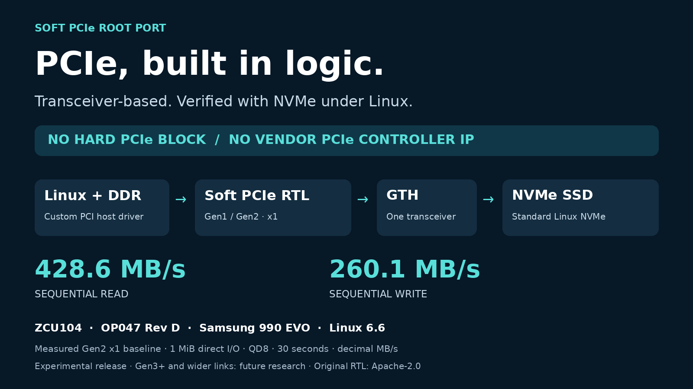

# Soft PCIe Root Port

**A transceiver-based PCIe root port in FPGA logic, verified with an NVMe SSD under Linux.**
No integrated hard PCIe controller or vendor PCIe controller IP is instantiated.
The implementation uses an AMD GTH transceiver, custom SystemVerilog protocol
logic, AXI interfaces and a Linux PCI host driver. Linux's standard NVMe driver
handles the SSD; this is not an FPGA NVMe command engine.



The frozen release is **Gen1/Gen2 x1**. Current development also offers an
optional **experimental Gen3 x1** backend. The PHY targets UltraScale+ GTHE4;
portability to other FPGA families and PCIe compliance are not claimed.

The latest Gen3 build measured **745.36 MB/s read and 567.71 MB/s write** at QD8
with 1 MiB direct I/O and 30-second runs. It uses 64-bit host RX/TX packet paths,
eight 64-byte DDR read-prefetch slots, and normal ACK retirement concurrent with
later original packets. Gen3-disabled packaging retains 32-bit packet paths and
two slots. The shared RTL has evolved beyond the frozen Gen2 source baseline;
its latest physical verification is on the Gen3-enabled image.

See the [performance improvement history](docs/performance-history.md) for the
measured progression, [configuration](docs/ip-guide.md#optional-gen3-packaging)
and [verification](docs/verification.md) for exact scope. Gen3 startup remains
intermittent, setup margin is only +0.004 ns, and full Recovery remains incomplete.
The historical Gen2 SD default is unchanged.

## Verified example

| Item | Configuration |
| --- | --- |
| FPGA board | AMD ZCU104, XCZU7EV-2FFVC1156 |
| Adapter used in testing | Opsero OP047 Rev D, SSD1, FMC LPC DP0 |
| SSD | Samsung 990 EVO 1 TB, MZ-V9E1T0 |
| Link | Gen2 x1, 5 GT/s; MPS128, MRRS512, RCB64 |
| Software | Linux 6.6.70, custom PCI host driver + standard NVMe driver |
| Sequential read / write | **428.58 / 260.06 MB/s**, 1 MiB, QD8, direct/libaio, 30 s |
| Verified baseline resources | 11,881 LUTs, 11,171 FFs, 2 BRAM tiles, one GTH |
| Verified baseline timing | WNS +0.284 ns; WHS +0.011 ns |

These measurements describe the complete ZCU104 example at the `txdouble_v1`
hardware baseline, not standalone-core utilization or guaranteed drive speeds.
See [validation and exact scope](docs/verification.md).
The historical banked-payload revision uses **10,864 LUTs / 9,294 FFs** and passed
physical Gen2 x1 I/O/CRC tests, with QD8 read/write **428.65 / 259.17 MB/s**.
The deployed Linux image now uses a persistent ext4 SD root.
The packaged example was also deployed and verified: QD8 read/write **428.33 / 259.73 MB/s**, within 0.13% of that baseline; all integrity checks passed.

**Adapter succession:** Opsero discontinued OP047 and names **OP063 (FPGA Drive
FMC Gen4)** as its replacement. The example was tested on OP047 Rev D, not OP063.
OP047 is sufficient for this release's Gen2 x1 limit. OP063's Gen4 capability
does not increase the core's speed or lane count. The example's power initializer
currently recognizes OP047 only; OP063 needs a reviewed bring-up change.
[Opsero OP047 notice](https://opsero.com/product/fpga-drive-fmc-dual/) ·
[OP063 product](https://opsero.com/product/fpga-drive-fmc-gen4/) ·
[adapter notes](examples/zcu104/README.md#adapter-compatibility).

## Repository layout

| Path | Purpose |
| --- | --- |
| `ip/soft_pcie_root/` | Reusable RTL and Vivado IP packager |
| `examples/zcu104/` | IP-based block design, physical constraints and audit |
| `software/driver/` | GPL-2.0-only Linux PCI host driver |
| `software/linux/` | Reproducible Buildroot/Linux/U-Boot example configuration |
| `tests/` | Protocol, ownership, DMA, CDC and software regressions |
| `docs/` | IP guide, register contract, validation and release notes |
| `docs/media/` | Editable graphic, PNG and LinkedIn draft |

## Build and test

Use Linux, Python 3.12+, GCC, Icarus Verilog, Verilator and **Vivado 2026.1** with
Zynq UltraScale+ device/board support. Source Vivado's `settings64.sh` first.
AMD XPM and GT Wizard/primitive simulation support come from that installation;
no generated AMD IP is committed here.

```sh
python3 -m venv .venv
.venv/bin/pip install -r requirements-dev.txt
make test lint
make ip IP_OUTPUT=build/ip_v1
make hardware OUTPUT=build/zcu104_v1 IP_REPO=build/ip_v1/core
make hardware-audit HARDWARE_OUTPUT=build/zcu104_v1 AUDIT_OUTPUT=build/audit_v1
```

Outputs must be fresh. `make ip` creates a local IP repository with VLNV
`soft-pcie.org:user:soft_pcie_root:1.0` (a local identifier, not a service URL).
The example instantiates that packaged IP. The frozen source provenance is checked
separately from generated build hashes. `make release-check` is a strict check
of the frozen Gen1/Gen2 baseline and is expected to reject this development tree's
shared RTL changes. Its historical manifests are preserved; do not regenerate
them to label experimental Gen3 as a qualified release. See [IP integration](ip/soft_pcie_root/README.md)
and [ZCU104 setup](examples/zcu104/README.md). These commands do not program a board.

## Scope and limitations

One direct endpoint, function 0 only; up to 16 MiB of endpoint BAR space; noncoherent
DMA to lower 2 GiB DDR in the example; 32 MSI/MSI-X vectors. The DDR master is 64-bit
AXI at 125 MHz; the ZCU104 interconnect converts to 128-bit PS HP0. Default
Gen1/Gen2 packaging has two read and two write owners, with 128 bytes of read
prefetch. Experimental Gen3 has eight read and two write owners, with 512 bytes.

No PCIe compliance certification, switch topology, Type 1 routing, multifunction,
INTx, hotplug, ASPM/AER or safe live PL replacement. Accepted AXI requests must
finish; local reset cannot cancel them. Use a disposable, unmounted SSD for
bring-up. See [integration and reset contract](docs/ip-guide.md),
[registers](docs/registers.md) and [future work](docs/roadmap.md).

## Licensing

Original RTL, tools and documentation: **Apache-2.0**. The Linux host driver in
`software/driver/` remains **GPL-2.0-only**. AMD-generated IP/libraries and fetched
upstream software retain their own licenses. The GPL pcievhost oracle is optional,
test-only and fetched into ignored build output; it is not synthesized or vendored.
See [LICENSE](LICENSE), [NOTICE](NOTICE) and [third-party notices](THIRD_PARTY.md).
