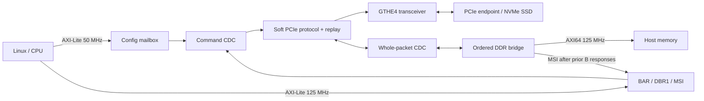

# Integration and architecture

The reusable boundary is `soft_pcie_root`; the Zynq processing system, clock
wizard, AXI interconnects, board pin assignments and Linux boot chain belong to
the example. The IP has no dependency on an AMD PCIe hard block. It does depend
on AMD GT Wizard-generated GTHE4 support and AMD XPM command/response FIFOs.

## Protocol and buffering

The link trains at Gen1 and supports switching to Gen2, single lane only. Fabric
logic implements framing, scrambling, CRC, flow control, ACK/NAK/replay, training
and the direct-endpoint requester. It is a root-port implementation with a limited
host integration, not a general switch fabric or a hardware NVMe controller.

MPS128, RCB64 read completions, reads up to 4 KiB with 64-bit address/range and 4 KiB
boundary checks. Requests below 4 GiB use 3 DW headers. Relaxed ordering and no-snoop
are disabled by the driver. Packet validation completes before DDR effects.

Two 256-byte serializer banks overlap collection/LCRC with wire transmission.
Two original packets can be copied ahead, but sent ownership advances only at
final wire completion. ACK/replay transitions wait for drain; replay stays
serialized. CPU command completion uses the wire packet's identity. The replay
store retains 8 x 64 DWORD (2 KiB); shared link RX storage is 4 KiB. Advertised posted
credits are 4 headers/32 data units (512 bytes), nonposted 2 headers/16 data units.
These capacities are conservative and relatively small.

Four validated pending request slots hold 4 x 36 DWORD (576 bytes), behind one active
ordered request. The DDR bridge has two outstanding same-ID AXI bursts, a 128-byte
write staging buffer, and two 64-byte completion slots. It does not concurrently
execute multiple endpoint read tags. CPU BAR/config operations remain single-tag.

## AXI, memory and ordering

The fixed integration supports one direct endpoint at bus 1/device 0/function 0;
root requester/completer ID 00:00.0. All assigned BARs fit a 16 MiB aperture. This
release retains the verified address constants; changing the base map requires
coordinated RTL, driver and device-tree changes.

`M_DDR` is 64-bit/125 MHz AXI4 with two outstanding reads/writes, max 8-beat bursts.
The example converts it to 128-bit PS HP0. DMA is noncoherent; Linux PCI DMA APIs
perform cache maintenance. Do not add `dma-coherent` or unrelated SMMU bindings.
The lower 2 GiB range guard is not an IOMMU or a security boundary. There is no
private memory reservation and no PL-attached DDR dependency in this example.

**All earlier accepted write responses, and held AW offers, fence MSI delivery,
reads and zero-byte flushes.** B errors suppress subsequent MSI. Held AXI offers
and accepted transactions drain on link loss/fault. Byte enables and partial
lanes are preserved. The Linux host driver pins itself after successful probe.

## Clocks, reset and constraints

- Management `aclk`: 50 MHz, independent of GTH, keeps SRP1 accessible.
- Host `host_clk_i` / `core_clk_o`: 125 MHz, stable during link rate changes.
- PCIe link: 125 MHz at Gen1, 250 MHz at Gen2; time at the fastest 4 ns period.
- Reference: 100 MHz differential, supplied to GTH and SSD from the adapter.

Global reset clears ownership with local synchronized release. Software PERST
must not clear mailbox/FIFO ownership or replay an old command. PERST_A is a
registered active-high FPGA output, held 100 ms after enable at 50 MHz. The adapter
inverts it to SSD PERST#. Packet RAM is unreset; state establishes validity.

No AXI watchdog can safely cancel an accepted memory transaction. No local reset,
live PL replacement, stopped-reference recovery or hot removal is supported.
Quiesce I/O and reboot/shut down Linux before reconfiguration. Link recovery that
preserves physical link ownership retains retry/buffer state; global recovery is
needed after fatal quarantine.

Use the example's clock, reset, Gray-pointer, held-data max-delay and bus-skew
constraints as the reviewed starting point. The reopened audit verifies exact
CDC stages, XPM instances, reset scopes, GTH reset/calibration wiring, HP0 width
and clocks, no PCIe hard primitive, route completion and timing. Porting must
re-establish those checks; do not downgrade DRCs or add blanket false paths.

## Interrupts and errors

The core intercepts MSI/MSI-X writes to 0xFEE00000 before DDR, with 32 vectors.
`irq_o` is level-high; the ZCU104 example uses PL IRQ0/GIC SPI89 (hwirq 121).
BAR failures return all-ones reads or retire writes instead of injecting ARM
external aborts. A 500 ms PIO timeout quarantines and drains late ownership.
Only one driver may own the registers: never use UIO or pcie-rootctl concurrently
with the bound Linux host driver.

Unsupported: Type 1 routing, multifunction/switch topology, INTx, hotplug, ASPM,
AER, arbitrary endpoint compatibility and PCIe compliance certification.
