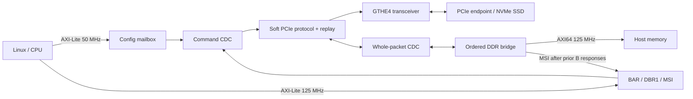

# Integration and architecture

The reusable boundary is `soft_pcie_root`; the Zynq processing system, clock
wizard, AXI interconnects, board pin assignments and Linux boot chain belong to
the example. The IP has no dependency on an AMD PCIe hard block. It does depend
on AMD GT Wizard-generated GTHE4 support and AMD XPM command/response FIFOs.



## Protocol and buffering

### Optional Gen3 packaging

Vivado now has one catalog definition, `soft-pcie.org:user:soft_pcie_root:1.1`, with an
**Enable experimental Gen3** checkbox. It defaults off. Generate a fresh local
repository once, containing both locally generated PHY backends:

```sh
vivado -mode batch -source ip/soft_pcie_root/package.tcl -tclargs build/package_next
```

In Vivado, add `build/package_next/core` under **Project Settings → IP → Repository**,
then use **Add IP → Soft PCIe Root Port (optional experimental Gen3)**. Double-click the
block, open **Configuration**, and select **Enable experimental Gen3** as needed. Apply
the customization and regenerate output products before synthesis/implementation. This
is not a runtime register.

The equivalent block-design Tcl is:

```tcl
create_bd_cell -type ip -vlnv soft-pcie.org:user:soft_pcie_root:1.1 pcie
set_property CONFIG.ENABLE_GEN3 true [get_bd_cells pcie]
```

Setting it to `false` selects Gen1/Gen2. The checkbox propagates to the HDL
`ENABLE_GEN3` parameter, selects exactly one PHY/link branch, and derives the host
packet width, prefetch depth and AXI read-outstanding metadata together. Both choices
reuse the host bridge, packet CDC, validation and replay ownership. Use the packaged
**Add IP** block-design cell for AXI automation. Vivado 2026.1 updates its
outstanding-read metadata correctly when the checkbox changes. The standalone
`create_ip` HDL wrapper retains the default two-read interface annotation even when
`ENABLE_GEN3=1`; its hardware still elaborates eight slots. Do not import that
standalone wrapper as a module reference for AXI automation. DDR AXI and external ports
remain unchanged. Generated native GT helpers have separate names to avoid collisions
with legacy GT helpers; native constraints are generated from the checkbox during
output-product generation and scoped to the customized IP. The disabled configuration
emits no native constraints.

The optional second packaging argument `0` or `1` now sets only the initial checkbox
value; it no longer creates separate catalog identities. The historical
`experiments/gen3/package_host.tcl` entry point delegates to the unified package with
its initial checkbox on. Version 1.0 Gen2 and experimental 0.1 packages are historical
artifacts; create a fresh 1.1 package rather than editing their XML. Remove the old
experimental repository from the project's IP repository list to avoid retaining its
separate legacy catalog entry.

Use the shared ZCU104 CDC entry point, `examples/zcu104/constraints/zcu104_cdc.tcl`; it
dispatches to the reviewed constraint set for the elaborated backend. The two board
build recipes explicitly select false/true on the same catalog core. Gen3 remains
experimental and needs further stabilization. Prior physical results refer to their
exact pre-unification images. The unified Gen3-enabled package has now passed full
synthesis, place-and-route, and an independent reopened checkpoint audit; see
[initial implementation evidence](evidence/catalog_gen3_v1/implementation.json).
The later startup-corrected unified image passed ten controlled warm-start/NVMe CRC
trials ([evidence](evidence/startup_fix_v1/completion.json)). The recipes defer board CDC constraints
until packaged IP checkpoints are linked, then apply them to the synthesis audit and
implementation. Constraint paths resolve from the project file, not the caller's Tcl path.

| Configuration | Host RX/TX packet width | Read prefetch | AXI outstanding reads/writes |
| --- | --- | --- | --- |
| Gen3 disabled | 32/32 bits at 125 MHz | 2 x 64 B = 128 B | 2 / 2 |
| Gen3 enabled | 64/64 bits at 125 MHz | 8 x 64 B = 512 B | 8 / 2 |

`M_DDR` remains AXI4 64-bit at 125 MHz in both configurations. Packet streams use
valid/ready plus packet-end and final-single-DWORD signals; they are internal streams,
not newly exposed AXI4-Stream ports. Gen3 uses a 64-bit whole-packet TX CDC and converts
to 32-bit DWORDs in the 250 MHz link domain. The link serializer and replay interfaces
retain their existing width. The selected host width and buffering stay fixed throughout
operation; the checkbox does not imply that the experimental native backend supports
runtime Gen2 fallback. Four packet CDC slots still hold up to 64 DWORDs each, and packet
credits/replay capacity do not change.

In wide mode, AR issuance and completion transmission have independent ownership.
Once all chunks of one validated SSD read have been issued, parsing can admit the
next read before the earlier completions finish. Each reserved completion slot
retains requester, tag, byte count, lower address, payload and error status.
Responses use one ordered AXI ID and completions remain in request/chunk order.
Writes, MSI, unsupported requests and zero-byte flushes wait for the earlier read
window to drain. Reads still fence all prior B responses and held write offers.
A failing read stops new issuance, emits CA for the failing slot when possible,
and drains all accepted bursts. Link loss drains held AR and accepted owners.
New control resets are synchronous; packet/payload RAM is unreset.

The 512-byte default is an estimate, not a measured performance guarantee. At 1 GB/s,
the previous approximately 258 ns burst residence requires about 258 B (five 64-byte
slots). Including roughly 88 ns to hand off a completion raises the estimate to six
slots; eight provides margin. This relies on overlapping DDR reads and adequate
sustained DDR bandwidth. The bridge parameter supports 2/4/8/16 slots for experiments;
packaged dimensions are fixed together with interface metadata and board audits. The
earlier separate Gen3 package passed full synthesis, routing and reopened audits. After
fixing an initial-link drain bug, that image also passed temporary NVMe I/O/CRC and
performance tests. Those performance results predate the unified 1.1 catalog. Its
startup-corrected Gen3 image subsequently passed full implementation and ten warm-start
read-only CRC trials. Its Gen3 setup margin was +0.002 ns; the later RX metadata
image reached +0.136 ns and passed physical I/O/CRC checks. Cold-cycle
qualification and full Recovery remain open. See
[verification](verification.md#startup-corrected-unified-gen3-image).

Independent native Gen3 simulation now checks all eight replay slots, cumulative
retirement/reuse, selective replay and natural sequence/credit rollover. These
checks do not qualify DDR prefetch depth, full Recovery or physical wire timing;
see the [Gen3 verification matrix](gen3-verification-matrix.md).

### Normal ACK retirement

The shared replay engine now retires acknowledged sent entries while later originals are
being copied or staged. Active slot/sequence identities stay latched; cumulative
retirement preserves the next staged/unsent identities. NAK/replay transitions retain
drain barriers, and unsent/future ACKs release nothing. The same-edge
last-old-ACK/new-wire-completion case starts a fresh timeout epoch. Packet RAM stays
unreset. Current physical tests cover both the Gen3-enabled and default Gen2
configurations, with separate builds and short I/O/CRC benchmarks. See [performance
history](performance-history.md) and [verification](verification.md).

### Earlier receive-width development change

The earlier RX64-only development host shell packed pairs of link-side DWORDs into a 64-bit receive
path at 125 MHz. A final-single-DWORD flag travels with each pair through the
whole-packet CDC. Its four packet slots still hold up to 64 DWORDs each; pairing
does not increase advertised credits or permit early publication of a packet.
The pending request queue and payload preparation also consume two DWORDs per
cycle. Three-DWORD headers, odd payload lengths, byte enables and address offset
four retain their original meaning. The DDR bridge can still be instantiated
with `RX_DWORDS=1`; that earlier host shell selected `RX_DWORDS=2`.

The packer's control reset is synchronous and uses the existing global reset
release chain. Link pauses retain partial pairs. Packet RAM remains unreset;
whole-packet validation, bank ownership transfer, accepted-AXI drain and the
all-B-before-MSI fence are unchanged. AXI remains 64-bit at 125 MHz, converted to
128-bit PS HP0; that earlier completion/transmit path remained 32-bit.

This raises the receive interface's raw capacity from 500 MB/s to 1 GB/s.
It does not guarantee that throughput through the full PCIe/DDR system doubles.
The historical release measurements predate this change.
Simulation and synthesis scope is recorded in
[development evidence](evidence/rx64_v1/development.json). The isolated BRAM and
resource check is reproducible with `vivado -mode batch -source
scripts/synth_rx64.tcl -tclargs build/rx64_synth_next` from the repository root.
Subsequent full Gen2 and Gen3 builds passed routing and reopened audits; see
[implementation evidence](evidence/rx64_v1/implementation.json). Temporary
physical tests passed I/O and CRC checks on both images, with Gen3 QD8 reads
at 741.81 MB/s; see [physical evidence](evidence/rx64_v1/completion.json).
This does not add cold-cycle, endurance, full Recovery or compliance qualification.

### Qualified protocol and ownership baseline

The link trains at Gen1 and supports switching to Gen2, single lane only. Fabric
logic implements framing, scrambling, CRC, flow control, ACK/NAK/replay, training
and the direct-endpoint requester. It is a root-port implementation with a limited
host integration, not a general switch fabric or a hardware NVMe controller.

MPS128, RCB64 read completions, reads up to 4 KiB with 64-bit address/range and 4 KiB
boundary checks. Requests below 4 GiB use 3 DW headers. Relaxed ordering and no-snoop
are disabled by the driver. Packet validation completes before DDR effects.

Two 256-byte serializer banks overlap collection/LCRC with wire transmission.
Two original packets can be copied ahead, but sent ownership advances only at
final wire completion. In the historical baseline, ACK/replay transitions waited for drain; replay
remains serialized. Current normal-ACK behavior is described above. CPU command completion uses the wire packet's identity. The replay
store retains 8 x 64 DWORD (2 KiB); shared link RX storage is 4 KiB. Advertised posted
credits are 4 headers/32 data units (512 bytes), nonposted 2 headers/16 data units.
These capacities are conservative and relatively small.

Four validated pending request slots hold 4 x 36 DWORD (576 bytes), behind one active
ordered request. The historical default DDR bridge has two outstanding same-ID AXI read bursts and two
64-byte completion slots. Write preparation and execution use alternating payload
RAM banks: validation transfers bank ownership without copying the payload.
Each bank holds up to 17 aligned 64-bit beats (including a partial edge beat),
with 32 beat positions reserved for simple addressing. The writer retains its
bank through the final W handshake; B-response ownership persists separately.
Control resets are synchronous and payload RAM is unreset. That baseline does not concurrently
execute multiple endpoint read tags; optional Gen3 read overlap is described above. CPU BAR/config operations remain single-tag.

## AXI, memory and ordering

The fixed integration supports one direct endpoint at bus 1/device 0/function 0;
root requester/completer ID 00:00.0. All assigned BARs fit a 16 MiB aperture. This
release retains the verified address constants; changing the base map requires
coordinated RTL, driver and device-tree changes.

`M_DDR` is 64-bit/125 MHz AXI4. The baseline has two outstanding reads/writes;
the optional Gen3 package has eight reads and two writes. Read bursts are at
most eight beats; an offset-four MPS128 write can require 17 beats.
The example converts it to 128-bit PS HP0. DMA is noncoherent; Linux PCI DMA APIs
perform cache maintenance. Do not add `dma-coherent` or unrelated SMMU bindings.
The lower 2 GiB range guard is not an IOMMU or a security boundary. There is no
private memory reservation and no PL-attached DDR dependency in this example.

**All earlier accepted write responses, and held AW offers, fence MSI delivery,
reads and zero-byte flushes.** B errors suppress subsequent MSI. Held AXI offers
and accepted transactions drain on link loss/fault. Byte enables and partial
lanes are preserved. The Linux host driver pins itself after successful probe.

## Clocks, reset and constraints

- Management `aclk`: 50 MHz, independent of GTH, keeps SRP1 accessible.
- Host `host_clk_i` / `core_clk_o`: 125 MHz, stable during link rate changes.
- PCIe link: 125 MHz at Gen1, 250 MHz at Gen2; time at the fastest 4 ns period.
- Reference: 100 MHz differential, supplied to GTH and SSD from the adapter.

Global reset clears ownership with local synchronized release. Software PERST
must not clear mailbox/FIFO ownership or replay an old command. PERST_A is a
registered active-high FPGA output, held 100 ms after enable at 50 MHz. The adapter
inverts it to SSD PERST#. Packet RAM is unreset; state establishes validity.

No AXI watchdog can safely cancel an accepted memory transaction. No local reset,
live PL replacement, stopped-reference recovery or hot removal is supported.
Quiesce I/O and reboot/shut down Linux before reconfiguration. Link recovery that
preserves physical link ownership retains retry/buffer state; global recovery is
needed after fatal quarantine.

Use the example's clock, reset, Gray-pointer, held-data max-delay and bus-skew
constraints as the reviewed starting point. The reopened audit verifies exact
CDC stages, XPM instances, reset scopes, GTH reset/calibration wiring, HP0 width
and clocks, no PCIe hard primitive, route completion and timing. Porting must
re-establish those checks; do not downgrade DRCs or add blanket false paths.

## Interrupts and errors

The core intercepts MSI/MSI-X writes to 0xFEE00000 before DDR, with 32 vectors.
`irq_o` is level-high; the ZCU104 example uses PL IRQ0/GIC SPI89 (hwirq 121).
BAR failures return all-ones reads or retire writes instead of injecting ARM
external aborts. A 500 ms PIO timeout quarantines and drains late ownership.
Only one driver may own the registers: never use UIO or pcie-rootctl concurrently
with the bound Linux host driver.

Unsupported: Type 1 routing, multifunction/switch topology, INTx, hotplug, ASPM,
AER, arbitrary endpoint compatibility and PCIe compliance certification.
